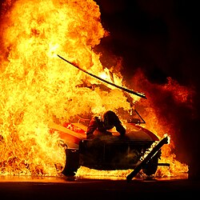
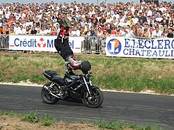
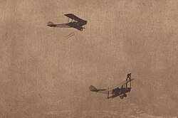

A stunt is an unusual, difficult, dramatic physical feat that may require a special skill, performed for artistic purposes usually for a public audience, as on television or in theaters or cinema. Stunts are a feature of many action films. Before computer-generated imagery special effects, these depictions were limited to the use of models, false perspective and other in-camera effects, unless the creator could find someone willing to carry them out, even such dangerous acts as jumping from car to car in motion or hanging from the edge of a skyscraper: the stunt performer or stunt double.

# Types of stunt effects

## Practical effects
One of the most-frequently used practical stunts is stage combat. Although contact is normally avoided, many elements of stage combat, such as sword fighting, martial arts, and acrobatics required contact between performers in order to facilitate the creation of a particular effect, such as noise or physical interaction. Stunt performances are highly choreographed and may be rigorously rehearsed for hours, days and sometimes weeks before a performance. Seasoned professionals will commonly treat a performance as if they have never done it before,[citation needed] since the risks in stunt work are high, every move and position must be correct to reduce risk of injury from accidents. Examples of practical effects include tripping and falling down, high jumps, extreme sporting moves, acrobatics and high diving, spins, gainer falls, "suicide backflips," and other martial arts stunts.[citation needed] Stunt airbags (or "stunt mats"), large deep airbags that may be the size of a small swimming pool, are typically used by professional stunt performers to cushion their landings from staged falls from heights.
## Mechanical effects

A physical stunt is usually performed with help of mechanics. For example, if the plot requires the hero to jump to a high place, the film crew could put the actor in a special harness, and use aircraft high tension wire to pull them up. Piano wire is sometimes used to fly objects, but an actor is never suspended from it as it is brittle and can break under shock impacts. Hero (2003) and House of Flying Daggers (2004) are examples of wuxia films that use kung-fu and are heavily reliant on wire stunts.[1] The Matrix is an example of extensive wire and rigging work in Western cinema.[2]
## Vehicular stunts

Performers of vehicular stunts require extensive training and may employ specially adapted vehicles. Stunts can be as simple as a handbrake turn, also known as the bootleg turn, or as advanced as car chases, jumps and crashes involving dozens of vehicles. Rémy Julienne is a well known pioneering automotive stunt performer and coordinator. A Guinness Book of World Records holder stunt driver, Bobby Ore, performed in numerous movies and events and holds a world record for longest distance driven on two wheels in a London double decker bus (810 feet).[3]
Aviation stunts go back to those performed in balloons in the 18th century. After the advent of powered aircraft in 1903, barnstorming and aerobatics came into existence. Ormer Locklear invented or helped develop many of the basic tricks of stunt flying, which included wing walking and transferring between airplanes in mid-air. Hollywood and the public's fascination with aviation made great demands on stunt pilots, resulting in many injuries and fatalities.
## Computer-generated effects

In the late 20th century stunt men were often placed in dangerous situations less and less as filmmakers turned to relatively inexpensive (and much safer) computer graphics effects using harnesses, fans, blue- or green screens, and a huge array of other devices and digital effects. The Matrix (1999) is an example of a film that extensively enhanced real stunts through CGI post production.[2] The Lord of the Rings film series and the Star Wars prequel films often display stunts that are entirely computer generated. Examples of computer-generated effects include face replacement and wire removal.
Stunts are a feature of many action films. Before computer-generated imagery special effects, these depictions were limited to the use of models, false perspective and other in-camera effects, unless the creator could find someone willing to carry them out, even such dangerous acts as jumping from car to car in motion or hanging from the edge of a skyscraper: the stunt performer or stunt double.

<video controls class="w-full rounded-2xl shadow-lg my-6">
  <source src="/videos/55859-504238916_medium.mp4" type="video/mp4">
  Your browser does not support the video tag.
</video>

